# Hi, I'm Tejas 👋

  
  

---

## 📊 GitHub at a glance

  
  
   
  

---

## ⚡ Recent activity

<!-- ACTIVITY:START -->
- 🚀 Pushed new commits to [farm-genius-voice](https://github.com/tejas-52/farm-genius-voice) 2026-11-01
- 🚀 Pushed new commits to [rentready-ai](https://github.com/tejas-52/rentready-ai) 2026-11-01
- 🚀 Pushed new commits to [copilot-rent-app](https://github.com/tejas-52/copilot-rent-app) 2026-11-01
- 🚀 Pushed new commits to [FixMyRide](https://github.com/tejas-52/FixMyRide) 2026-11-01
- 🚀 Pushed new commits to [Oasis-Data-Science-Internship](https://github.com/tejas-52/Oasis-Data-Science-Internship) 2026-11-01

Updated automatically every day · last refresh 2026-11-13
<!-- ACTIVITY:END -->

---

## 🔥 Featured projects

<table>
  <tr>
    <td width="50%" valign="top">
      <h3><a href="https://github.com/tejas-52/rentready-ai">🏠 RentReady AI</a></h3>
      AI rental-application copilot that prepares complete, verified applications.  
      
      
    </td>
    <td width="50%" valign="top">
      <h3><a href="https://github.com/tejas-52/krishi-mitra-ai">🌾 KrishiMitra AI</a></h3>
      AI farming advisor for Indian farmers in Hindi, Marathi and English, with a <a href="https://github.com/tejas-52/farm-genius-voice">voice-first version</a>.  
      
    </td>
  </tr>
  <tr>
    <td width="50%" valign="top">
      <h3><a href="https://github.com/tejas-52/ai-health-atlas">🩺 AI Health Atlas</a></h3>
      Municipal health-planning dashboard with Streamlit and R Shiny front ends.  
      
      
    </td>
    <td width="50%" valign="top">
      <h3><a href="https://github.com/tejas-52/ml-engineer-roadmap">🧠 ML Engineer Roadmap</a></h3>
      My ML-engineering practice repo, with experiments tracked in Weights &amp; Biases.  
      
      
    </td>
  </tr>
  <tr>
    <td width="50%" valign="top">
      <h3><a href="https://github.com/tejas-52/FixMyRide">🚗 FixMyRide</a></h3>
      Roadside-assistance app connecting drivers and mechanics, with Firebase and an Android build.  
      
      
    </td>
    <td width="50%" valign="top">
      <h3><a href="https://github.com/tejas-52/orbitnet-mesh">🛰️ OrbitNet Mesh</a></h3>
      Satellite-assisted communication and data-relay system for space transportation.  
      
    </td>
  </tr>
</table>

---

## 🎮 Play tic-tac-toe with me

<!-- TTT:START -->

| | A | B | C |
|:-:|:-:|:-:|:-:|
| **1** | [⬜](https://github.com/tejas-52/tejas-52/issues/new?title=ttt%7Cmove%7CA1&body=Just%20click%20**Create**%20to%20play%20this%20move.%20You%20don't%20need%20to%20write%20anything.%0A%0AThe%20bot%20replies%20within%20about%20a%20minute.) | [⬜](https://github.com/tejas-52/tejas-52/issues/new?title=ttt%7Cmove%7CB1&body=Just%20click%20**Create**%20to%20play%20this%20move.%20You%20don't%20need%20to%20write%20anything.%0A%0AThe%20bot%20replies%20within%20about%20a%20minute.) | [⬜](https://github.com/tejas-52/tejas-52/issues/new?title=ttt%7Cmove%7CC1&body=Just%20click%20**Create**%20to%20play%20this%20move.%20You%20don't%20need%20to%20write%20anything.%0A%0AThe%20bot%20replies%20within%20about%20a%20minute.) |
| **2** | [⬜](https://github.com/tejas-52/tejas-52/issues/new?title=ttt%7Cmove%7CA2&body=Just%20click%20**Create**%20to%20play%20this%20move.%20You%20don't%20need%20to%20write%20anything.%0A%0AThe%20bot%20replies%20within%20about%20a%20minute.) | ❌ | ⭕ |
| **3** | [⬜](https://github.com/tejas-52/tejas-52/issues/new?title=ttt%7Cmove%7CA3&body=Just%20click%20**Create**%20to%20play%20this%20move.%20You%20don't%20need%20to%20write%20anything.%0A%0AThe%20bot%20replies%20within%20about%20a%20minute.) | [⬜](https://github.com/tejas-52/tejas-52/issues/new?title=ttt%7Cmove%7CB3&body=Just%20click%20**Create**%20to%20play%20this%20move.%20You%20don't%20need%20to%20write%20anything.%0A%0AThe%20bot%20replies%20within%20about%20a%20minute.) | [⬜](https://github.com/tejas-52/tejas-52/issues/new?title=ttt%7Cmove%7CC3&body=Just%20click%20**Create**%20to%20play%20this%20move.%20You%20don't%20need%20to%20write%20anything.%0A%0AThe%20bot%20replies%20within%20about%20a%20minute.) |

You're ❌. **Click any ⬜ to play**, and the bot (⭕) answers within about a minute.

**Score:** Visitors 0 · Bot 0 · Draws 0

Recent moves: @tejas-52 → B2 (bot → C2)

<!-- TTT:END -->

---

## 🗳️ Help me choose

<!-- POLL:START -->
**What should I build next?**

| Idea | Votes | |
|:--|:--|:-:|
| 🗺️ AI trip planner for budget travel | `░░░░░░░░░░░░` 0 | [Vote](https://github.com/tejas-52/tejas-52/issues/new?title=vote%7Ctravel&body=Just%20click%20**Create**%20to%20vote%20for%3A%20%F0%9F%97%BA%EF%B8%8F%20AI%20trip%20planner%20for%20budget%20travel) |
| 🗣️ Voice AI language tutor | `░░░░░░░░░░░░` 0 | [Vote](https://github.com/tejas-52/tejas-52/issues/new?title=vote%7Ctutor&body=Just%20click%20**Create**%20to%20vote%20for%3A%20%F0%9F%97%A3%EF%B8%8F%20Voice%20AI%20language%20tutor) |
| 🚁 Crop-health app using drone photos | `░░░░░░░░░░░░` 0 | [Vote](https://github.com/tejas-52/tejas-52/issues/new?title=vote%7Cdrone&body=Just%20click%20**Create**%20to%20vote%20for%3A%20%F0%9F%9A%81%20Crop-health%20app%20using%20drone%20photos) |
| 📄 Open-source rental-documents checker | `░░░░░░░░░░░░` 0 | [Vote](https://github.com/tejas-52/tejas-52/issues/new?title=vote%7Cdocs&body=Just%20click%20**Create**%20to%20vote%20for%3A%20%F0%9F%93%84%20Open-source%20rental-documents%20checker) |

0 votes so far · one vote per person, and voting again changes your vote
<!-- POLL:END -->

---

## ✍️ Guestbook

<!-- GUESTBOOK:START -->

- No messages yet. Be the first to sign!
<!-- GUESTBOOK:END -->

Everything in this section updates through GitHub issues: clicking a link opens a ready-made issue, and a GitHub Action updates this page within about a minute.

---

<b>🛠️ Tech stack</b> (click to expand)

 

  

<b>🌱 What I'm working on</b> (click to expand)

 

- Production ML engineering: experiment tracking, evaluation and deployment
- AI copilots that finish real paperwork, such as rental applications
- Multilingual, voice-first assistants for farmers

<b>⏰ When I code</b> (click to expand)

 

  

---

  <picture>
    <source media="(prefers-color-scheme: dark)" srcset="https://raw.githubusercontent.com/tejas-52/tejas-52/output/github-snake-dark.svg" />
    <source media="(prefers-color-scheme: light)" srcset="https://raw.githubusercontent.com/tejas-52/tejas-52/output/github-snake.svg" />
    
  </picture>

